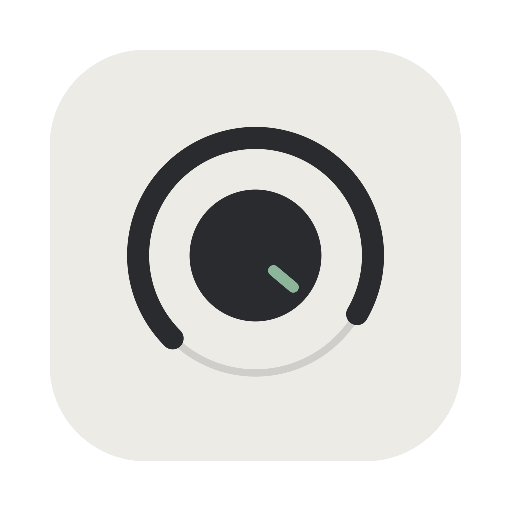
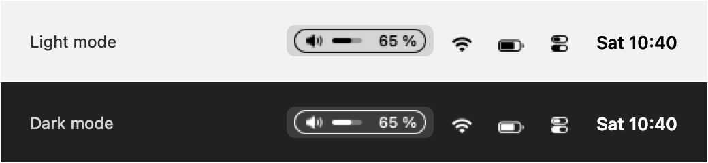
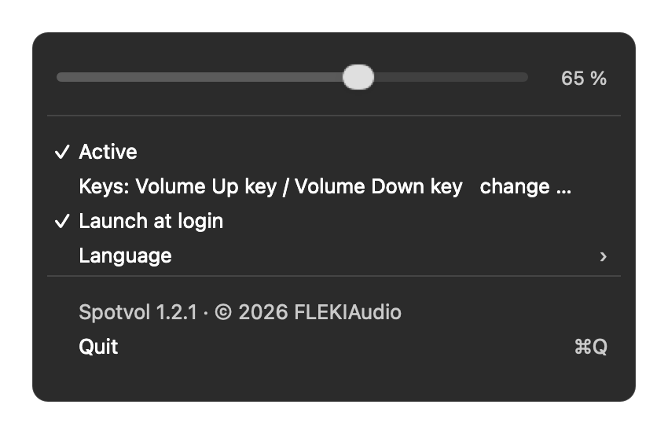
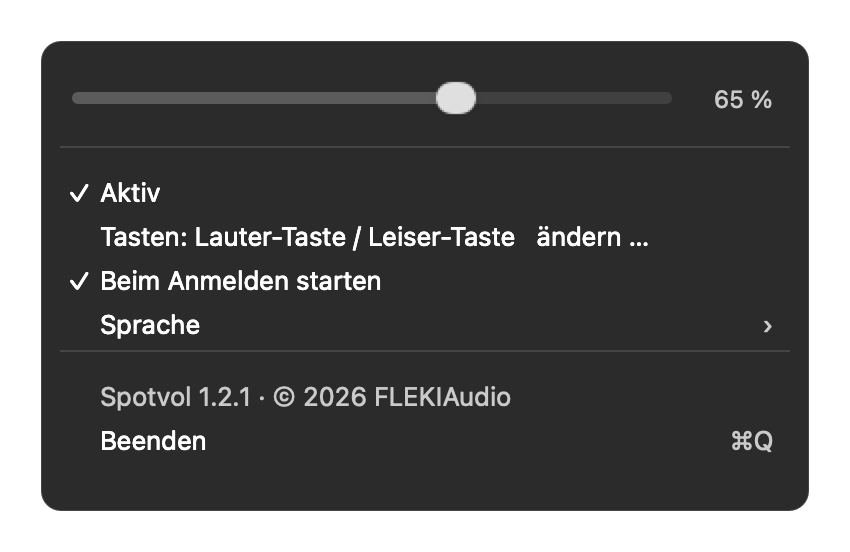
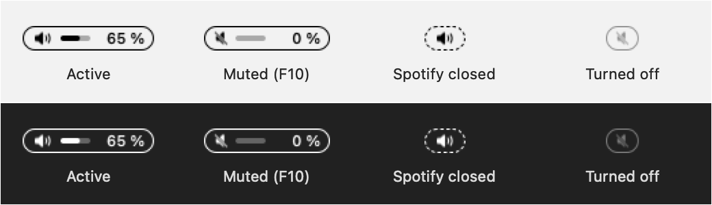

<p align="center"></p>

<h1 align="center">Spotvol</h1>

<p align="center">Control the <b>Spotify volume</b> with your Mac's regular volume keys, instead of the system volume.</p>

<p align="center"></p>

---

## Why?

When Spotify plays on another device through **Spotify Connect** (a TV, a speaker, a soundbar), your Mac's volume keys do nothing for that device, because they only change the Mac's own output. The only way to make it louder or quieter is the volume slider inside Spotify.

Spotvol fixes that: while Spotify is open, **F11 / F12** change the Spotify volume, even when Spotify is in the background and you're working in another app.

## Features

- **F11 / F12** (volume down / up) change the Spotify volume in 5 % steps.
- **F10** (mute) mutes Spotify; press it again to restore the previous volume.
- When Spotify is **not running**, Spotvol does nothing, so your keys control the Mac as usual.
- The menu bar shows the current Spotify volume as an icon, a mini bar and a percentage, all in one thin outline.
- The menu has a volume slider, an on/off switch, custom key bindings and launch at login.
- **English or German**: English by default, switch any time under **Language** in the menu. The change applies instantly.
- It's lightweight: one Swift file, no dependencies, about 0 % CPU when idle.

<p align="center">
  
  
</p>

### Menu bar states

<p align="center"></p>

## Installation

1. Download `Spotvol-x.y.dmg` from [Releases](../../releases), open it and drag **Spotvol** into **Applications**.
2. The app isn't notarized by Apple, so macOS blocks it on first launch. To open it anyway:
   **System Settings → Privacy & Security → "Open Anyway"**, or right-click the app → **Open**.
3. Grant two permissions:
   - **Accessibility**, so Spotvol can catch the volume keys.
   - **Automation → Spotify**, asked on the first key press, so Spotvol can set Spotify's volume.

Requirements: a Mac with Apple Silicon (M1 or newer), macOS 13 or later, and the Spotify desktop app.

The app starts in English. To switch to German, open the menu and choose **Language → Deutsch**.

## Building from source

You need the Xcode Command Line Tools (`xcode-select --install`).

```bash
zsh build.sh        # builds Spotvol.app
zsh build.sh dmg    # also builds Spotvol-<version>.dmg
```

The app is ad-hoc signed. If you build it yourself, grant the Accessibility permission again once.

## Privacy

- Spotvol **never sends any data over the internet**. There is no networking code, no analytics and no telemetry.
- It stores only three settings, locally in `~/Library/Preferences/local.spotivol.app.plist`:
  - whether Spotvol is turned on,
  - your key bindings for volume up and down,
  - the app language (English or German).
- Only when something goes wrong (for example Spotify doesn't respond) does it write a short message to `~/Library/Logs/Spotvol/spotvol.log`. That file is kept under about 100 KB.
- It talks only to the local Spotify app, through AppleScript, to read and set the volume.
- About catching keys: by default Spotvol only looks at the media keys (volume up, volume down, mute). Only if you set custom keys does it also check regular key presses against your binding. Key presses are **never stored or sent anywhere**.

### Uninstall

Quit the app and delete `Spotvol.app`. If you also want to remove its settings and log, run:

```bash
defaults delete local.spotivol.app
```

```bash
rm -rf ~/Library/Logs/Spotvol
```

Then remove its entry in **System Settings → Privacy & Security → Accessibility**.

## Disclaimer

Spotvol is an independent hobby project. It isn't affiliated with, endorsed by or connected to Spotify AB. "Spotify" is a trademark of Spotify AB.

## License

[MIT](LICENSE) © 2026 FLEKIAudio
